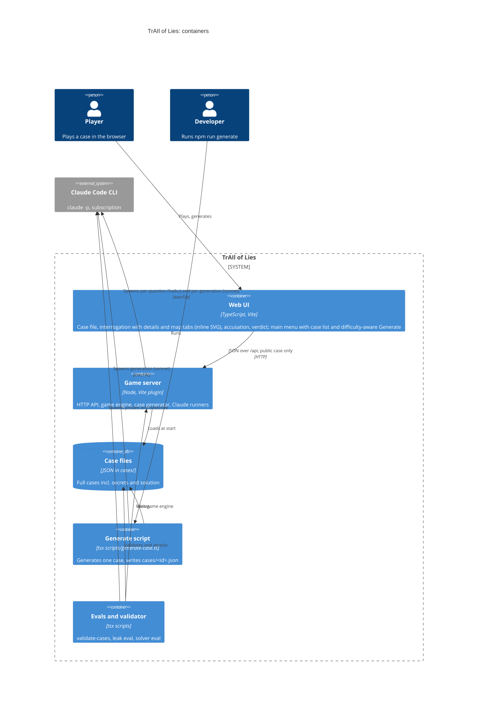

# C4 level 2: Containers

- Browser only receives `toPublicCase` data before the accusation (ADR-002); the generate route returns `{ caseId, title }` only.
- The public case includes the claimed-locations map, never true positions (ADR-007).
- Game state and button-generated cases live in server memory (ADR-003, ADR-005); only `npm run generate` writes `cases/`.
- Case generation uses sonnet with validation-error retries (ADR-005, spec 002). Evals are in ADR-004.
