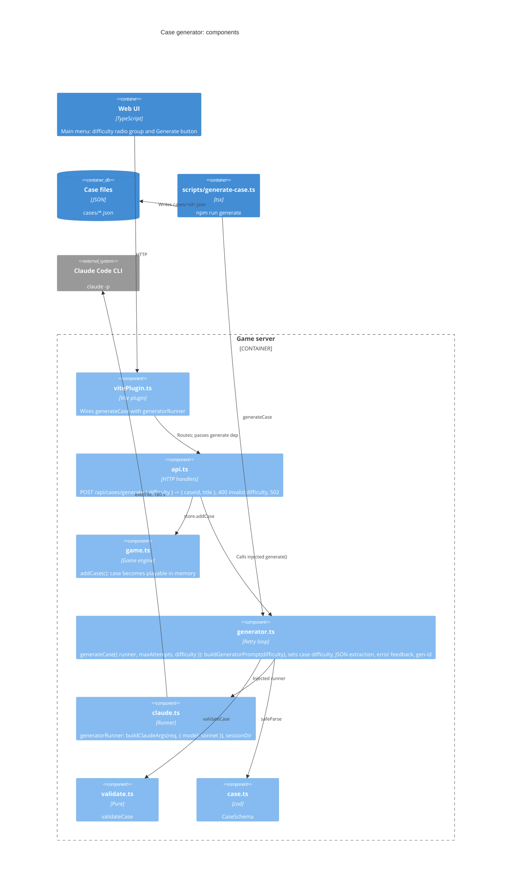

# C4 level 3: Components of the case generator

- `generator.ts` depends on the runner type only; retries resume the same session with validation errors (ADR-005).
- `api.ts` takes the generator as an optional dependency, so tests use a fake; `createApiHandler(store)` still works.
- Generation tokens are not charged to game ledgers (ADR-005).
- Difficulty (ADR-008): `api.ts` validates the body (default medium, else 400) and calls `generate(difficulty)`; the generator prompt carries the level's rules, the validator rules of spec 005 are unchanged; `npm run generate -- --difficulty <level>` passes the same value.
