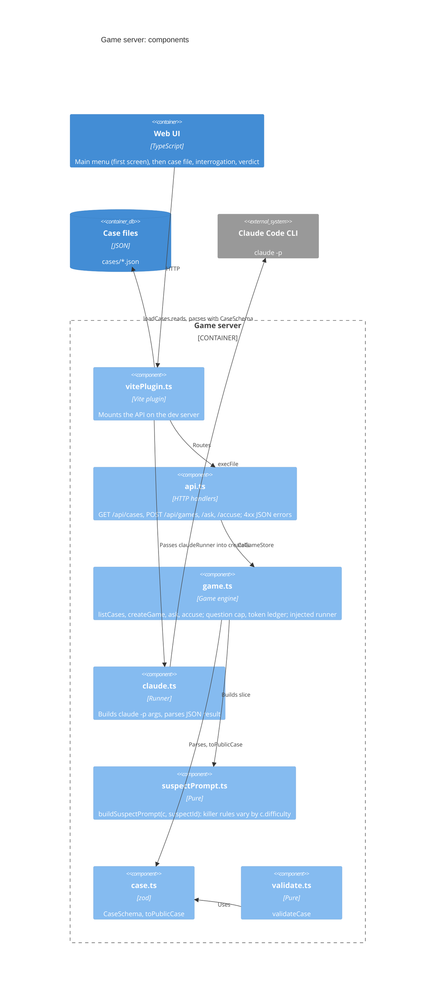

# C4 level 3: Components of the game server (play a case)

- `game.ts` depends on the runner type only; `vitePlugin.ts` builds the store with `claudeRunner` and `loadCases()` (ADR-003). `api.ts` only receives the store.
- `claude.ts` keeps one empty temp dir per session id: Claude Code stores sessions per working directory, so `--resume` must run in the same cwd as the first call (ADR-001).
- `GET /api/cases` returns `{ caseId, title, difficulty }[]` from `store.listCases()` and nothing else; the menu uses it to list playable cases (ADR-008). Difficulty never changes the question cap or token budget.
- Prompt slicing in `suspectPrompt.ts` (ADR-002); subprocess flags in `claude.ts` (ADR-001).
